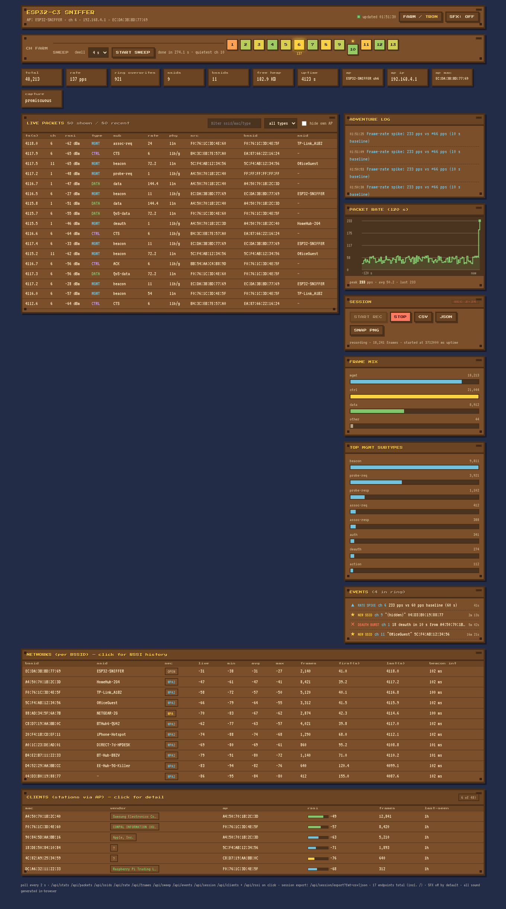
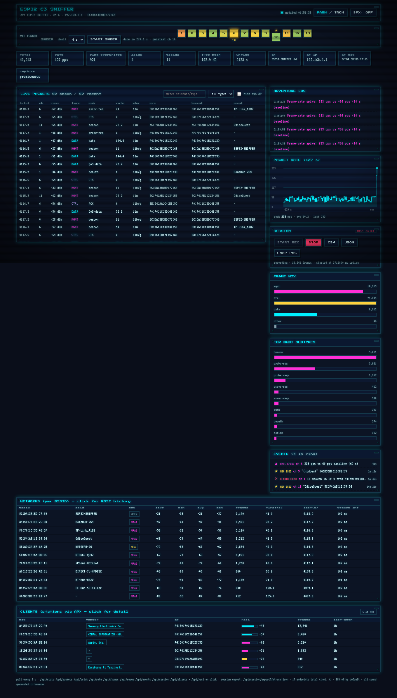

# ESP32-C3 SuperMini WiFi Sniffer

A **standalone passive 2.4 GHz WiFi channel analyser** with an offline **8-bit dashboard**, running on a ~£5 ESP32-C3 SuperMini. No internet, no cloud, no accounts — the board hosts its own access point; you connect and open the dashboard.



## Quick start

1. Build and flash (see [Build](#build--flash)).
2. Power the board and join the access point **`ESP32-SNIFFER`** (open, channel 6).
   > On a laptop, join with a *spare* USB Wi-Fi adapter — joining any AP disconnects your primary adapter's network (including VPNs).
3. Open **http://192.168.4.1**.
4. Watch the Channel Farm fill in, hit **START SWEEP** to walk all 13 channels, and see the EVENTS panel log new networks, deauth bursts and rate spikes as they happen.

## Features

- **CH FARM** — live activity across all 13 2.4 GHz channels, with sweep progress overlay
- **Sweep mode** — 2–10 s dwell per channel, baseline comparison, moved/quietest-channel recommendation, NVS-persisted home channel
- **LIVE PACKETS** — capture ring with subtype names, type filter, hide-own-traffic toggle
- **NETWORKS** — per-BSSID table (RSSI, rates, SSID), row-click RSSI history chart
- **PACKET RATE** — 120 s throughput chart with peak marker; **FRAME MIX** and **TOP MGMT SUBTYPES** bars
- **EVENTS engine** — on-device anomaly detection: `NEW_SSID` (60 s grace), `DEAUTH_BURST` (3 in 10 s), `RATE_SPIKE` (≥2× vs 60 s baseline, 15 s rearm), suspicious pairs; littleFS-backed ring + `/api/events`
- **ADVENTURE LOG** — the dashboard narrates discoveries in retro style
- **FARM / TRON themes** + procedural 8-bit SFX (WebAudio) — everything is local; the UI has **zero external resources** (two OFL fonts embedded as data-URIs)
- **Serial console** — `sweep [2-10|stop]`, `home`, `ch <1-13>`, `diag`, `events [clear]`

## Architecture

| Layer | What it is |
|---|---|
| Firmware | `src/main.cpp` — 2,111 lines, Arduino framework, **legacy** `esp_wifi_set_promiscuous*` API (IDF 4.4-compatible), all timing loop/`millis()`-driven |
| Dashboard | `data/index.html` — 772 lines, single file, no build step, no dependencies |
| API | 11 GET endpoints, 2 s polling via `Promise.allSettled` |
| Storage | littleFS event ring (`/events.json`, 16 KB cap, 5 s debounce flush) + NVS (`sniffer/homech`) |
| Bounds | 512-packet ring · 64 BSS · 32 SSID · 32 events · saturation-safe semantics |

## HTTP API

| Endpoint | Purpose |
|---|---|
| `/` | Dashboard (littleFS) |
| `/api/stats` | Totals, uptime, heap, capture state |
| `/api/packets?n=` | Capture ring (newest first) |
| `/api/ssids` | Detected SSIDs |
| `/api/rssi?bssid=` | Per-BSSID RSSI history |
| `/api/rate` | 120 s packet-rate window |
| `/api/frames` | Frame-type mix |
| `/api/events` | Anomaly engine ring (`{"count":N,"events":[…]}`) |
| `/api/sweep` | Sweep state/results |
| `/api/sweep/start?dwell=` | Start sweep (2–10 s dwell) |
| `/api/sweep/stop` | Stop sweep, restore home |

## Build & flash

Pin-locked toolchain (the exact matrix used for every commissioned build):

| Component | Version |
|---|---|
| PlatformIO Core | 6.1.19 |
| platform | `espressif32@6.11.0` (board `esp32-c3-devkitc-02`) |
| framework | `arduino-esp32 3.20017.241212` |
| toolchain | `riscv32-esp 8.4.0` |

```sh
pio run                 # firmware (≈39.9% flash / 31.0% RAM)
pio run -t buildfs      # littleFS image (dashboard + events)
pio run -t upload       # flash firmware over native USB-Serial-JTAG
pio run -t uploadfs     # flash dashboard filesystem
```

Known quirks worth documenting: a `460800` baud USB-Serial-JTAG resync race can appear on first upload attempt (identical retry works; only hold the physical **BOOT** button if esptool cannot enter download mode), and a `HARDWARE EXCEPTION` log line during `uploadfs` is expected post-reset noise.

## Hardware

- **ESP32-C3 SuperMini** (ESP32-C3FN4, 4 MB flash, no PSRAM), USB-C powered
- User button on GPIO9 (`button_check()`, 4 s long-press)
- Native USB CDC on boot (`ARDUINO_USB_MODE=1`) — serial console is the USB serial itself

## Limitations (honest list)

- **Passive analysis only.** This project never injects frames — deauth events are *observed* over the air, not caused. It is a site-survey tool, not an attack tool.
- 2.4 GHz / 802.11b/g/n only (single radio).
- The SoftAP is **open** (lab device). Do not expose the device on trusted infrastructure.
- Activity percentages and RSSI are **relative** indicators; no calibrated noise-floor claims.
- Bounded rings saturate in dense RF environments (drop semantics documented above).

## Roadmap

- [x] S1 — MVP capture + dashboard
- [x] S2 — 8-bit UI (FARM/TRON, SFX)
- [x] S3 — Channel sweep + commissioning (C1/C2, byte-verified partitions)
- [x] S4 — Event/anomaly engine (on-device commissioning in progress)
- [ ] S5 — Session logging + CSV/JSON export + PNG snapshot
- [ ] S6 — Offline OUI vendor lookup + client tracker
- [ ] S7 — Beacon sequence analysis (BSS uptime/restart detection)
- [ ] S9 — Device config panel + presets + status LED + OTA

## Provenance

Every commissioned build in this repo's lineage was verified the same way: hash-gated source → clean PlatformIO build → flash → **esptool byte-level read-back** of both partitions, with SHA-256 compared against the build artifacts. Screenshot below is the dashboard as served by the device.



## License

Code and dashboard: **MIT** (Dion Croft). Embedded pixel fonts (Press Start 2P, VT323): **SIL Open Font License 1.1** — see [docs/NOTICE.md](docs/NOTICE.md).
